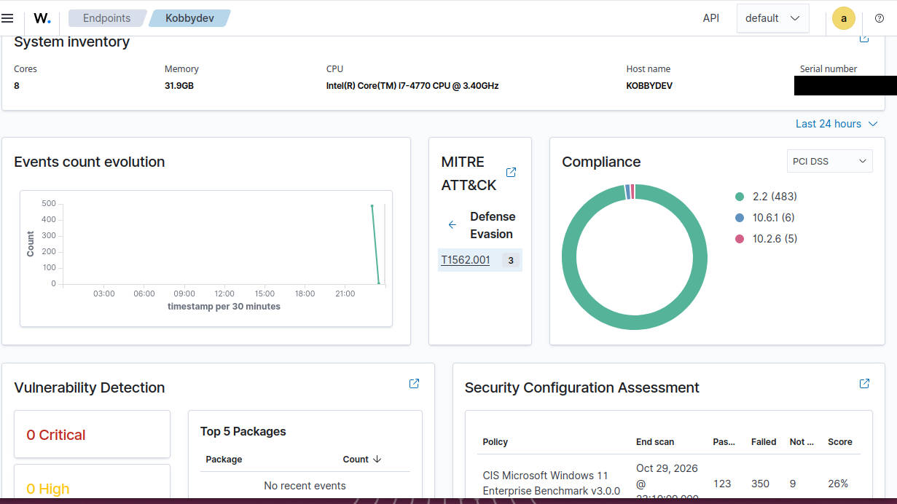
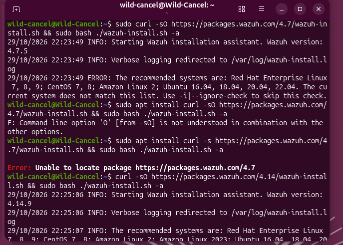
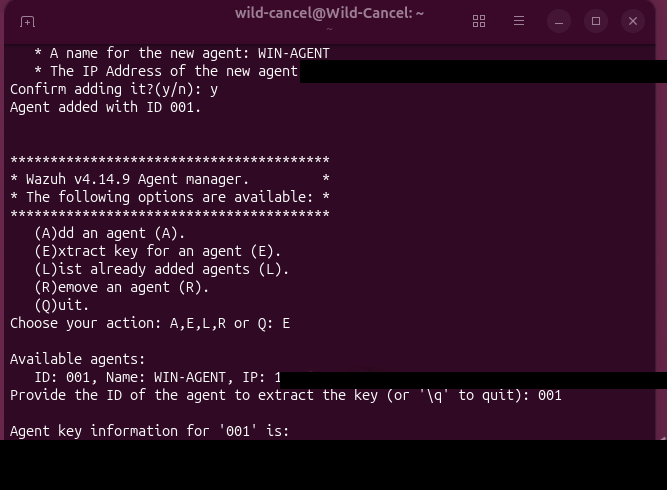
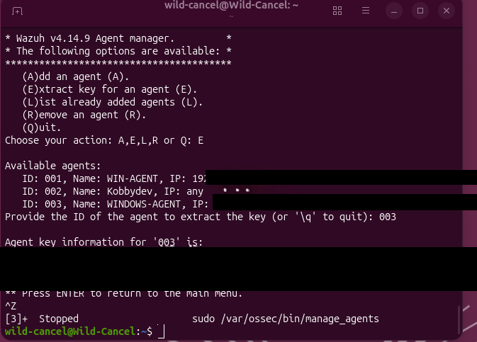
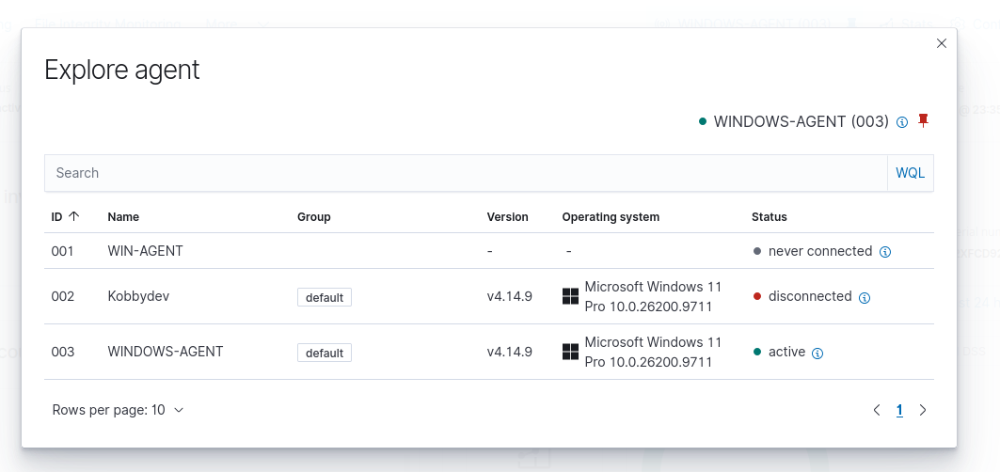

# SIEM Home Lab with Wazuh

A home security operations lab built with **Wazuh 4.14.9** on Ubuntu, monitoring **Windows 11** endpoints. The lab centralizes endpoint logs, maps activity to MITRE ATT&CK, checks systems against CIS benchmarks and PCI DSS, and uses custom detection rules to alert on file and folder changes.



---

## Lab setup

| Component | Details |
|---|---|
| SIEM server | Wazuh 4.14.9 (manager, indexer and dashboard) on Ubuntu |
| Endpoints | Windows 11 Pro machines running the Wazuh agent |
| Features used | Security Configuration Assessment (SCA), MITRE ATT&CK mapping, PCI DSS compliance, vulnerability detection, system inventory, custom rules |

```
Windows 11 endpoints (Wazuh agents)
            │  security events and logs
            ▼
Wazuh server on Ubuntu  ──►  rules, decoders and custom detections
            │
            ▼
Wazuh dashboard  ──►  alerts, MITRE ATT&CK, compliance, vulnerabilities
```

---

## Installation and troubleshooting

The install did not work the first time, and fixing it was one of the most useful parts of the project.

- The installation assistant **warned that my Ubuntu version was not on its recommended systems list**.
- My first attempts used an **older installer version (4.7)** and **incorrect command syntax** (mixing `apt install` with `curl` options), which failed with errors.
- I switched to the **correct 4.14 installer** and the right `curl` command, which completed the installation.



**Lesson:** read error messages carefully, check that versions match the documentation, and confirm OS compatibility before installing.

---

## Agent enrollment

I used Wazuh's agent manager (`manage_agents`) to register Windows endpoints and extract their authentication keys, then enrolled the agents on the Windows machines.





*Agent keys and IP addresses are redacted. Agent keys allow a machine to report to the server, so they should never be shared publicly.*

Enrollment took more than one attempt. The agent list shows an early entry that never connected, alongside the Windows 11 agents that enrolled successfully and reported to the server.



---

## Findings

### Security Configuration Assessment (CIS benchmark)
My Windows 11 machine scored **26%** against the **CIS Microsoft Windows 11 Enterprise Benchmark v3.0.0**: **123 checks passed, 350 failed, 9 not applicable**.

This shows how much a default Windows install needs hardening before it meets a security baseline.

### MITRE ATT&CK
Activity on the endpoint was mapped to **T1562.001 – Impair Defenses: Disable or Modify Tools**, under the **Defense Evasion** tactic (3 events). I researched this technique to understand how attackers disable or tamper with security tools to avoid detection, and how MITRE ATT&CK helps analysts recognize known attacker behavior.

### PCI DSS compliance
Events were mapped to PCI DSS requirements, including **2.2** (secure system configuration, 483 events), **10.6.1** (6 events) and **10.2.6** (5 events).

### Vulnerability detection and inventory
Wazuh's vulnerability detection and system inventory gave a single view of each endpoint's hardware, software and known vulnerabilities (0 critical and 0 high at the time of the scan).

---

## File monitoring

I configured Wazuh **File Integrity Monitoring (FIM)** in real-time mode on the Windows 11 agent to detect:
- creation of files and folders
- modification of files
- deletion of files, folders and downloaded content

When a change happens, Wazuh's built-in rules raise alerts (554 file added, 550 file modified, 553 file deleted).

Configuration: [`config/agent-syscheck.xml`](config/agent-syscheck.xml)

---

## Skills demonstrated

- **SIEM deployment and administration**: installing Wazuh, enrolling agents, troubleshooting install and enrollment issues
- **Detection engineering**: writing custom rules for file and folder activity
- **Threat frameworks**: mapping activity to MITRE ATT&CK techniques and tactics
- **Compliance and hardening**: CIS benchmarks, Security Configuration Assessment, PCI DSS
- **Vulnerability management**: endpoint inventory and vulnerability detection
- **Linux and Windows administration**: Ubuntu server and Windows 11 endpoints
- **Security practices**: redacting secrets (agent keys, IP addresses) before publishing

---

## Next steps

- [ ] Harden the Windows 11 endpoint and re-run the CIS assessment to measure improvement
- [ ] Simulate attacks (e.g. with Atomic Red Team) and confirm the rules detect them
- [ ] Connect my [IOC Triage Tool](https://github.com/25dominic/comp-triage) to enrich Wazuh alerts with VirusTotal and AbuseIPDB
- [ ] Add Sysmon to the Windows endpoints for more detailed process and network logs

---
## Documentation

- [Real-Time File Integrity Monitoring (Windows + Linux)](realtime-monitoring.md)
