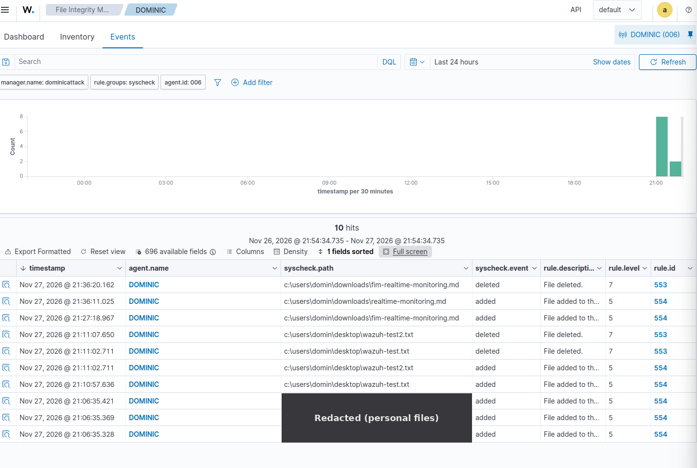
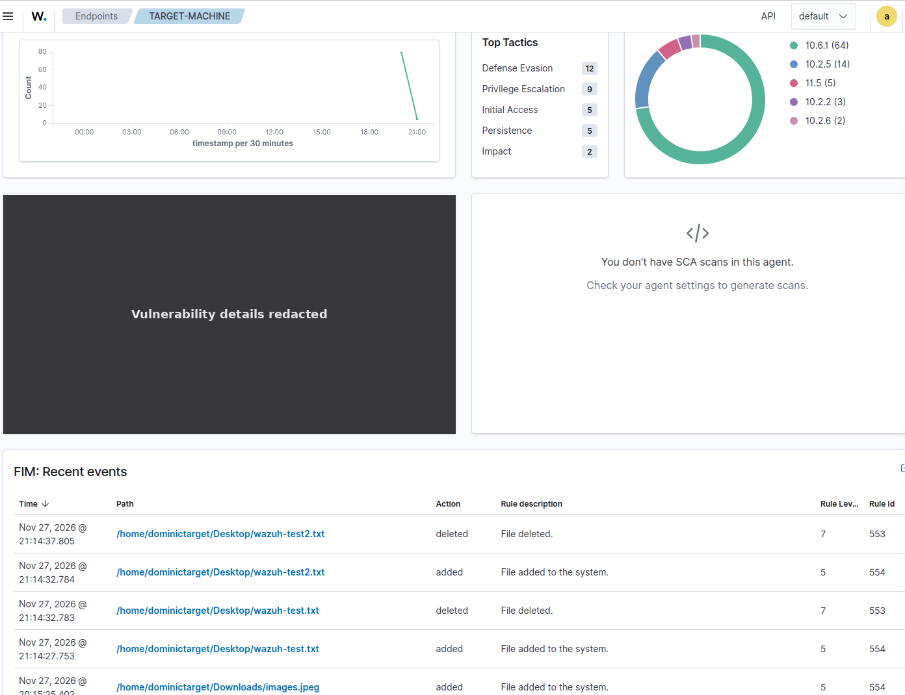
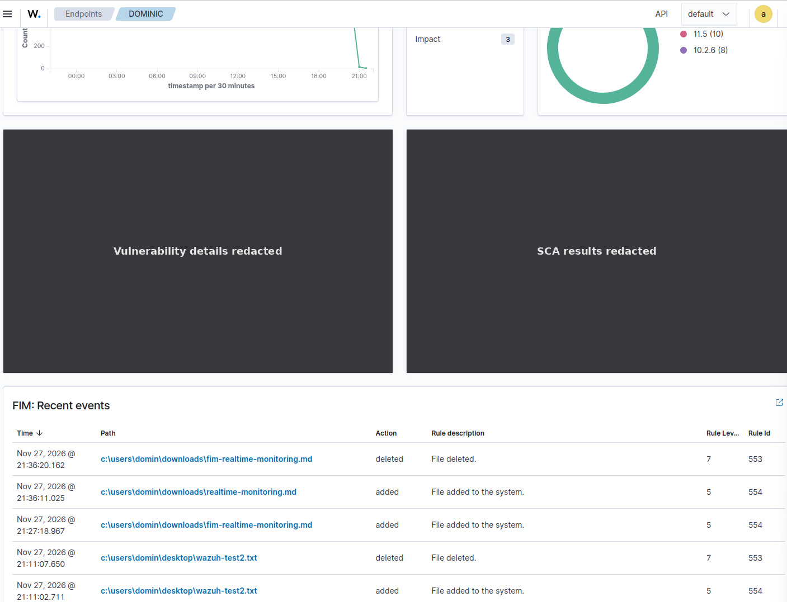

# Real-Time File Integrity Monitoring (FIM)

This module sets up **real-time file monitoring with user and process attribution (who-data)** on Windows and Linux endpoints. Wazuh then alerts within seconds when a file is created, modified, renamed, copied, downloaded or deleted, and records who did it and which program did it.

## Lab setup

| Role | System | Notes |
|---|---|---|
| Wazuh server (manager, indexer, dashboard) | Ubuntu VM (VMware, NAT) | All-in-one install, Wazuh 4.14.x |
| Endpoint 1 | Windows 11 host | Wazuh agent (MSI) |
| Endpoint 2 | Ubuntu/Debian Linux | Wazuh agent (.deb) |

> Replace `<WAZUH_SERVER_IP>` and `<user>` in the examples with your own values.

---

## Monitoring scope

| What I monitored | Why |
|---|---|
| The user's personal folders: Desktop, Downloads, Documents, Pictures, Videos, Music | This is where user activity happens: downloads, copies, edits, deletions |
| Secondary data drive (optional) | Data drives don't contain the OS, so watching the whole drive doesn't produce much noise |

| What I deliberately left out | Why |
|---|---|
| The `C:\` root | Windows Update, Defender, pagefile, prefetch and temp files would produce thousands of alerts and use up the FIM file limit |
| `AppData` / `~/.cache`, `~/.config`, `~/.mozilla` | Browser and app caches change constantly and add no security value |
| Temporary download files (`.crdownload`, `.tmp`, `.part`) | They create duplicate events while a download is in progress |

---

## Windows agent

### 1. Install the agent

The agent version must be **the same as or older than** the manager version. Check the manager's version on the server:

```bash
sudo /var/ossec/bin/wazuh-control info
```

Install it from an **Administrator** PowerShell window:

```powershell
$msi = "$env:TEMP\wazuh-agent.msi"
Invoke-WebRequest -Uri "https://packages.wazuh.com/4.x/windows/wazuh-agent-<VERSION>-1.msi" -OutFile $msi
(Get-Item $msi).Length   # should be several MB; a tiny file means you downloaded a web page
Start-Process msiexec.exe -ArgumentList "/i `"$msi`" /qn WAZUH_MANAGER=<WAZUH_SERVER_IP>" -Wait
NET START WazuhSvc
```

> The most reliable way to get the right install command is the dashboard: **Deploy new agent → Windows**. It always matches your server version.

### 2. Add the monitored folders

Edit `C:\Program Files (x86)\ossec-agent\ossec.conf`. The new lines must go **inside** `<syscheck>`, just before `</syscheck>`:

```xml
<syscheck>
  ...
  <directories realtime="yes" whodata="yes">C:\Users\<user>\Desktop</directories>
  <directories realtime="yes" whodata="yes">C:\Users\<user>\Downloads</directories>
  <directories realtime="yes" whodata="yes">C:\Users\<user>\Documents</directories>
  <directories realtime="yes" whodata="yes">C:\Users\<user>\Pictures</directories>
  <directories realtime="yes" whodata="yes">C:\Users\<user>\Videos</directories>
  <directories realtime="yes" whodata="yes">C:\Users\<user>\Music</directories>
  <ignore>C:\Users\<user>\AppData</ignore>
  <ignore type="sregex">.crdownload$|.tmp$|.part$</ignore>
</syscheck>
```

Here is a safe way to add the folders from PowerShell. It backs up the file first, inserts the lines as plain text (no regex), and saves as UTF-8 without a BOM:

```powershell
$conf = "C:\Program Files (x86)\ossec-agent\ossec.conf"
Copy-Item $conf "$conf.working.bak" -Force
$lines = "Desktop","Downloads","Documents","Pictures","Videos","Music" |
  ForEach-Object { "    <directories realtime=`"yes`" whodata=`"yes`">C:\Users\<user>\$_</directories>" }
$text = [IO.File]::ReadAllText($conf).Replace("</syscheck>", (($lines -join "`r`n") + "`r`n  </syscheck>"))
[IO.File]::WriteAllText($conf, $text, (New-Object Text.UTF8Encoding($false)))
NET STOP WazuhSvc; NET START WazuhSvc
```

### 3. Verify

```powershell
Get-Service WazuhSvc
Select-String -Path "C:\Program Files (x86)\ossec-agent\ossec.log" -Pattern "Connected|Monitoring path|Whodata engine started|ERROR" | Select-Object -Last 10
```

These lines confirm it's working:

```
INFO: (4102): Connected to the server ([<WAZUH_SERVER_IP>]:1514/tcp).
INFO: (6003): Monitoring path: 'c:\users\<user>\desktop', with options '... | whodata'.
INFO: (6012): Real-time file integrity monitoring started.
INFO: (6019): File integrity monitoring real-time Whodata engine started.
```

---

## Linux agent

### 1. Install the agent

```bash
wget https://packages.wazuh.com/4.x/apt/pool/main/w/wazuh-agent/wazuh-agent_<VERSION>-1_amd64.deb
sudo WAZUH_MANAGER='<WAZUH_SERVER_IP>' dpkg -i ./wazuh-agent_<VERSION>-1_amd64.deb
sudo systemctl daemon-reload
sudo systemctl enable --now wazuh-agent
```

Who-data on Linux depends on `auditd`:

```bash
sudo apt-get update && sudo apt-get install -y auditd
sudo systemctl enable --now auditd
```

### 2. Add the monitored folders

Add these to `/var/ossec/etc/ossec.conf`, inside `<syscheck>`. `/mnt` and `/media` are where extra drives and USB storage mount, so they play the role of `D:\` on Windows:

```xml
<directories realtime="yes" whodata="yes">/home/*/Desktop</directories>
<directories realtime="yes" whodata="yes">/home/*/Downloads</directories>
<directories realtime="yes" whodata="yes">/home/*/Documents</directories>
<directories realtime="yes" whodata="yes">/home/*/Pictures</directories>
<directories realtime="yes" whodata="yes">/home/*/Videos</directories>
<directories realtime="yes" whodata="yes">/home/*/Music</directories>
<directories realtime="yes" whodata="yes">/mnt</directories>
<directories realtime="yes" whodata="yes">/media</directories>
<ignore>/home/*/.cache</ignore>
<ignore>/home/*/.config</ignore>
<ignore>/home/*/.mozilla</ignore>
<ignore type="sregex">.crdownload$|.tmp$|.part$|.swp$</ignore>
```

```bash
sudo systemctl restart wazuh-agent
sudo grep -iE "Monitoring path|whodata|ERROR" /var/ossec/logs/ossec.log | tail -n 10
```

---

## Testing

**Windows (PowerShell):**

```powershell
"wazuh test" | Out-File "C:\Users\<user>\Desktop\wazuh-test.txt"
Start-Sleep -Seconds 5
Rename-Item "C:\Users\<user>\Desktop\wazuh-test.txt" "wazuh-test2.txt"
Start-Sleep -Seconds 5
Remove-Item "C:\Users\<user>\Desktop\wazuh-test2.txt"
```

**Linux (bash, as your normal user, not root):**

```bash
echo "wazuh test" > ~/Desktop/wazuh-test.txt
sleep 5
mv ~/Desktop/wazuh-test.txt ~/Desktop/wazuh-test2.txt
sleep 5
rm ~/Desktop/wazuh-test2.txt
```

**Where to see the results:**

- Dashboard: **File Integrity Monitoring → Events**. Select the agent and set the time range to the last 15 minutes.
- On the server: `sudo grep -i "wazuh-test" /var/ossec/logs/alerts/alerts.log | tail -n 5`

| Action | Rule | Description |
|---|---|---|
| File created, copied or downloaded | 554 | File added to the system |
| File modified | 550 | Integrity checksum changed |
| File deleted or moved out | 553 | File deleted |
| File renamed | 553 + 554 | Delete + add pair |

Expand any event to see `syscheck.audit.user.name` (who made the change) and `syscheck.audit.process.name` (which program, for example `explorer.exe` or `powershell.exe`).
```

### Windows endpoint: real-time FIM events


### Linux endpoint: real-time FIM events


### Windows endpoint overview


---

## Troubleshooting log

These are the problems I actually ran into while building this, and how I fixed them.

| Symptom | Cause | Fix |
|---|---|---|
| `Invoke-WebRequest : Access to the path 'C:\wazuh-agent.msi' is denied` | Wrote `${env.tmp}` instead of `$env:TEMP`, so the variable was empty | Use `$env:TEMP` |
| `System error 5: Access is denied` on `NET START WazuhSvc` | PowerShell wasn't running as Administrator | Open PowerShell with **Run as administrator** (prompt shows `C:\WINDOWS\system32>`) |
| `ERROR: (4112): Invalid server address found: '0.0.0.0'` | The `<address>` in `ossec.conf` was never set to the manager's IP | Set `<address><WAZUH_SERVER_IP></address>` and restart the service |
| `ERROR: Duplicate agent name` | The agent lost `client.keys`, but the server still had the old registration | On the server: `sudo /var/ossec/bin/manage_agents -l`, then `-r <ID>`, then restart the agent |
| `ERROR: (1226): Error reading XML file 'ossec.conf': (line 0)` | The config was missing, broken or unreadable. Causes I hit: the file was deleted, lines were pasted **outside** `<syscheck>`, and the file was rewritten by a PowerShell `[xml]` save. A drive-root path with a trailing backslash (`D:\</directories>`) is also a likely cause, because the parser may read `\<` as an escape. | Restore a known-good backup, keep `<directories>` lines inside `<syscheck>`, and write drive paths without a trailing backslash (`D:`) |
| Downloaded "installer" was a web page | The install URL was wrong (it pointed to the website homepage) | Check the downloaded file's size, or copy the command from **Deploy new agent** in the dashboard |
| No FIM events from the Desktop | **OneDrive Known Folder Move**: the real Desktop, Documents and Pictures were at `C:\Users\<user>\OneDrive\...` | Check with `[Environment]::GetFolderPath("Desktop")`, then either monitor the OneDrive paths or move the folders back to the local profile |
| `WARNING: (6922): Cannot open '...\documents\my music': Access is denied` | Legacy Windows junction points inside Documents (`My Music`, `My Pictures`, `My Videos`) | Harmless. Optionally ignore them with `<ignore type="sregex">documents.my music\|documents.my pictures\|documents.my videos</ignore>` |
| `wazuh-agent.service does not exist` on the server | Tried to start an agent on the all-in-one server, which runs `wazuh-manager` and has no agent | Install agents only on the endpoints |
| Agent shows **Disconnected** after a VM reboot | The VM's DHCP address changed | Give the Wazuh server a static IP (Netplan) |

### Lessons learned

- **Back up `ossec.conf` before every change.** Being able to restore it in one line saved a lot of time:
  ```powershell
  Copy-Item "C:\Program Files (x86)\ossec-agent\ossec.conf.working.bak" "C:\Program Files (x86)\ossec-agent\ossec.conf" -Force; NET STOP WazuhSvc; NET START WazuhSvc
  ```
- **Make one change at a time and restart after each.** When something breaks, you know which change did it.
- **Read the agent log first.** `ossec.log` named the exact cause of every failure.
- **`realtime="yes"` doesn't depend on the scan interval.** The `<frequency>` setting (43200 s by default) only controls the scheduled full scan. Real-time folders alert right away.
